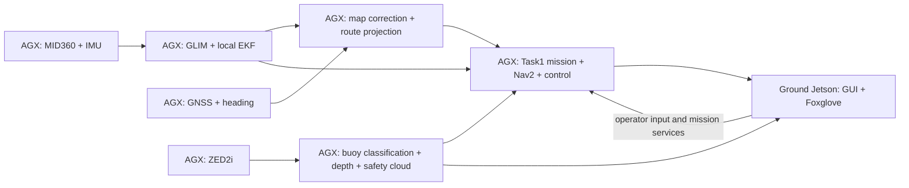
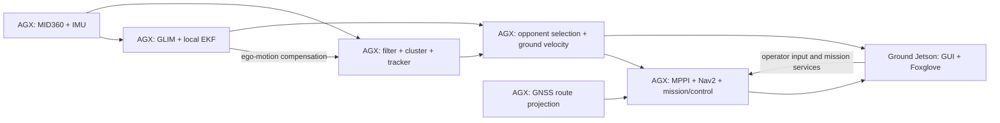

# AGX onboard / Jetson ground: Task1 and Task2

2026-10-14. AGX 100.73.137.72; ground Jetson 100.115.34.103.
Both workspaces: /home/ibo/njord2026_ws, branch fix/agx-startup.

## Launch

AGX: choose one task, never both concurrently:

    ros2 launch robot agx_task1.launch.py enable_mid360:=true
    ros2 launch robot agx_task2.launch.py enable_mid360:=true

Ground Jetson, common to both:

    ros2 launch robot ground_jetson.launch.py

Live Foxglove: ws://100.115.34.103:8765. Historical preview: port 8766.
Nav2 is opt-in with enable_nav2:=true; no mission starts automatically.
Propulsion is disabled by default. Do not also run legacy compute jetson_bringup.

## Ownership and frames

AGX owns sensors, GLIM GPU, base/lever-arm correction, local EKF, optional GNSS
map EKF, Task1 camera buoy perception/safety clouds, or Task2 LiDAR filtering,
segmentation/tracking/opponent selection and MPPI. Mission/control/Nav2 are onboard.
Ground receives telemetry/video, offers mission services, sends critical_link input.
Zenoh no longer imports perception or odometry back from ground into AGX.

/odometry/filtered/local has parent odom and child base_link. GLIM dynamic TF is
private; its static mounting TF subscription remains public. Local EKF alone
owns odom->base_link. GNSS map EKF alone owns map->odom, using GNSS XY, absolute
ENU heading and local body velocity. It never feeds corrected pose back to local EKF.
Task2 tracker/selector share local odom and use odom for perception/planning.

Existing Task1/Task2 GPS routes use odom. Public /fromLL therefore projects with
local odom AND GNSS ENU heading, rather than assuming GLIM yaw is true east.
Global map projection services are under /localization/map. Neither projector
broadcasts UTM TF. Other map-frame route consumers (e.g. return-home) still need
a separate frame audit before autonomous deployment.

Task1 hardcoded surveyed-buoy ROI is disabled by default: its coordinates have
no verified datum in the first-fix map. Camera classification/depth is the primary
buoy source. The LiDAR ROI detector waits for valid /buoy_roi. A calibrated survey
can be enabled explicitly through onboard_perception enable_surveyed_buoy_roi:=true.

## Verification

Installed official koide3 PPA GLIM 1.2.2 CUDA13.1 on AGX CUDA13.2; the GPU library
loaded and processed recorded data. https://koide3.github.io/glim/installation.html
Built pcl_preprocessing, pcl_segmentation, ship_tracking and dependencies from
recorded-data-tested submodule revision 89975bf on AGX.

Isolated ROS_DOMAIN_ID=79, with no drivers, live bridges or actuators:
/home/ibo/rosbags/agx_glim_smoke_90s is the first 90 seconds of
/home/ibo/rosbags/aug10_acquisition_ordered. Payloads unchanged. Historical IMU
uses g (glim_acc_scale:=9.80665); live scaled IMU uses 1.0.
Task2 35-second observer received 289 raw/local odom, 569 global odom, 103 tracked
object messages and 280 GNSS map projections. Expected TF chain was present;
/cmd_vel had zero publishers. No selected-opponent twist: the mission corridor
was not initialized. Tracks are not proof of correct ship classification.
Task1 observer received 142 local odom and 285 global odom messages. Safety filter
and LiDAR buoy detector loaded. Bag contains no images, so classification cannot
be validated from this bag. Nine adapter/parameter/heading unit tests passed.

Global correction availability was checked, NOT improved accuracy. Earlier bag
comparisons did not justify GNSS fusion into local GLIM odometry. Assumed sensor
extrinsics and adapter covariances require measurement/tuning before field use.

## Prior map

Prior-map localization is not implemented. A future matcher must fuse with or
replace the map estimator, not become a second map->odom publisher. Local/global
map-building modules remain disabled in the onboard GLIM odometry profile.

## Hardware limitations

AGX end0 is 192.168.0.41; MID360S config expects host 192.168.1.5 and sensor
192.168.1.114. Live MID360 is unverified. Temporary live Task1 validation uses
enable_glim:=false (legacy GNSS fallback) until LiDAR networking is ready.
Default task profiles select GLIM. Bag GPU success is not live latency qualification.
ZED2i opens but HD720/15 reports CORRUPTED FRAME; USB enumerates at 5000M.
GNSS reports malformed GPGST covariance, so live position quality is unverified.
VGA camera retry and final running state are documented below after checking.

VGA/15 retry succeeded: 220 image messages and 225 buoy detection-array messages
in 15 seconds. This proves image/inference publishing, not correctness of buoy
class labels. Only the initial frame was corrupted. VGA/15 is now the AGX default.
The inherited camera YAML disabled all depth-cloud output; the dedicated AGX YAML
enables it for Task1 near-field safety. Final cloud/bridge verification follows.
Final 15-second Task1 live check: AGX depth clouds 225, buoy arrays 224,
near-field safety clouds 68. Ground Jetson received 224 buoy arrays and 44
/ground_video/image/compressed messages. No field objects were labeled for accuracy.
Historical port-8766 preview was kept running throughout. Current live AGX is
agx_task1.launch.py enable_glim:=false, VGA/15, propulsion/Nav2 disabled.

## Task1 system diagram

## Task2 system diagram

Diagrams show configured responsibilities. See hardware limitations for what is
currently running live and what has only been verified from recorded data.

Ground station was restarted with permission and the updated bridge rules.
Final 15-second ground reception: safety cloud 71, buoy array 222, camera 45.
Both Task1/Task2 configurations are installed; hardware/live limitations above
remain. No propulsion or autonomous mission was started.
