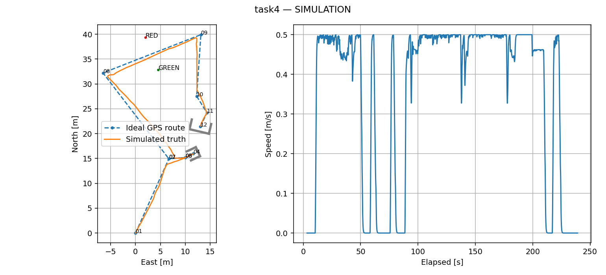
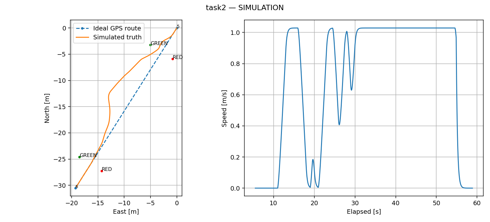

# センサなしシミュレーションの実装・検証記録

Task2の2026-11-13のcostmap修正・追加検証は
[追加記録](task2_costmap_fix_20261113.md)を参照してください。
以下は2026-11-12時点の構成・結果です。

2026-11-12。実センサ・実機の駆動は使用していません。
Mission Manager → Nav2 / Task2 planner → Control Manager → command arbiter
→ シミュレーション運動モデルを実行しました。タスクごとの独立したsim起動です。

## 実装したこと

- Task1 / 1.2は既存の競技用ENU配置と長い仮想壁を使用。GPS3の到達成功で壁を有効化。
  現在の実機用短距離ウェイポイントYAMLは変更せず、sim用の経路・registryを生成。
- Task2は模擬LiDAR点群を既存のフィルタ・地面除去・クラスタ・追跡・他船選択に入力。
  プランナーに他船の真値を渡さず、追跡値と検出ブイを使用。
  simでは観測値に基づく経路検査と回避方向保持も有効化。純粋なMPPI単独の合格とは扱わない。
- Task3通常・縦列とTask4の連続走行・両停泊。停泊中の動きや古いodomでは待機時間を進めない。
  最終方位の上書きと、ゴール判定器が実行中の設定変更を無視する問題を修正。
- GNSS・方位・IMU・odom・ブイ・点群を模擬生成。ノイズありではGaussian誤差と位置バイアスのrandom walkを使用。
  真値トピックをナビゲーション用の値と分け、接触・枠内収容・停泊時間を評価。
- Foxglove Mission Controlパネルを追加。タスク選択・開始・停止・進捗、要求モードと実効出力、
  AUTO阻害理由、Task2の経路判定による停止、Health、色名と点滅周期、直前の終了結果、3秒以上古い状態を表示。
  タスクの理想経路・sim推定軌跡も公開。

参照した既存仕様は [task registry](../src/mission/mission_manager/config/task_registry.yaml)、
[Task1配置](../src/sim/task1_sim/config/task1_params.yaml)、
[Task3経路](../src/navigation/path_generator/waypoint_publisher/config/task3_waypoints.yaml)、
[状態灯の説明](../docs/status-lights.md) です。壁保持・通過後解除の履歴 `7adaf5e8`、
Task4両停泊の履歴 `c750f135` と現在のstaged経路を優先しました。
競技公式規則の完全準拠を示す試験ではありません。

## 公式handbookとの照合

2026-11-12に公開ページも確認しました。[Task1本文](https://njord.gitbook.io/2026/9-task-descriptions/9.1-maneuvering-and-path-finding)の、
GUIで指定GNSS経路と航跡を比べること、方位標識に従うこと、GPS3からの再開始、GPS4での停止を今回の検証に対応させています。
ただし同ページ自身が前回大会の説明で今後更新すると記載し、
[避航](https://njord.gitbook.io/2026/9-task-descriptions/9.2-collision-avoidance)と
[停泊](https://njord.gitbook.io/2026/9-task-descriptions/9.3-docking)の現在の本文は2027年初頭の仕様更新予定を示しています。
公開ページを確定済みの競技仕様とは扱わず、この実装ではrepoのTask2=避航、Task3=停泊、Task4=既存複合経路というIDを保ちました。
新しい公式の番号・配置・条件が確定した時点で、対応表とfixtureを照合する必要があります。

## 合格条件と仮定

Missionの成功だけでは合格にしません。Task1系は有効化中の非空の仮想壁点群も要求します。全WP通過、船体接触ゼロ、方位ブイの正しい側、
最後の静止を要求します。停泊は船体全体が枠内にある真値を使い、静止確認2秒後、
通常10秒・縦列5秒を連続計測します。Task2は両ゲート通過、他船選択、
船体間隔0.5m以上、正面遭遇の右転、右側交差で船尾側通過も確認します。

停泊時間、2×2m / 4×2mの模擬停泊枠、その開口方向、Task2の5mゲート配置、
Task4の通過ブイ配置は明示的なsim仮設定です。通常停泊枠の向きは接近点→停泊点から作り、
sim用目標方位を整合させています。実測の構造物配置やセンサ誤差分布とは異なります。

## 試験結果

最終matrixの結果を下表に集約します。数値と各試験の構成は
[acceptance.json](simulation_results/acceptance.json) と `simulation_results/cases/` に保存。
代表試験には生成設定・真値CSV・軌跡図も含めます。元の全ログは `/tmp/njord-night/` にあります。

| 対象 | 合格数 | 最小ブイ余裕[m] | 最小他船間隔[m] | 確認事項 |
| --- | --- | --- | --- | --- |
| Task1 | 4/4 | 0.204 | — | 真値＋ノイズ3seed・有効化中の壁点群あり |
| Task1.2 | 4/4 | 0.220 | — | 真値＋ノイズ3seed・有効化中の壁点群あり |
| Task2 head_on | 4/4 | 0.836 | 2.192 | 両ゲート・右側回避・最終停止 |
| Task2 port | 4/4 | 0.634 | 4.852 | 両ゲート・最終停止 |
| Task2 starboard | 4/4 | 0.903 | 4.303 | 両ゲート・最終停止・船尾側通過 |
| Task2 none | 4/4 | 1.676 | — | 両ゲート・最終停止 |
| Task3.1 通常停泊 | 4/4 | — | — | 接触0・最小停泊 10.30s |
| Task3.2 縦列停泊 | 4/4 | — | — | 接触0・最小停泊 5.30s |
| Task4 | 4/4 | 2.075 | — | 接触0・最小停泊 10.30s / 9.00s |
| Task1.2 MMG | 1/1 | 0.216 | — | 真値・旧壁監視版（方位側・接触・到達を確認） |
| 停止・センサ欠測 | 2/2 | — | — | 各1回・typed cancellation・出力ゼロ |

通常走行36ケース、MMG 1ケース、故障・停止2ケースの計39ケースが合格。
代表的な過去の不合格2ケースも別区分で保持しています。

実行過程には未commitの調整も含むため、各 `run.json` のcommitだけで同一構成だったとは
扱わないでください。PythonソースのSHA256と各試験の設定ファイルSHA256も保存しています。
Task1 / 1.2は仮想壁の有効化に加え、実際に非空の壁点群を受けたことを要求した版で
真値・ノイズ3seedを揃えています。MMGのTask1.2と故障試験は、その壁監視強化より前の結果です。

## 失敗からの変更

[調整ログ](simulation_tuning_log.md) に「挙動 → 変更 → 結果」を記録しました。
MPPI単独のポート側交差ではMission成功でも船体間隔0.019mで不合格でした。
最初の経路検査版も正面seed 2028で左右の候補を反転し、接触して不合格でした。
これらを `superseded_failure` として結果JSONに残し、合格ケースに混ぜていません。
方向保持の修正後は別の出力先でmatrixを再実行しています。

8コアの試験ホストで多数同時実行するとTF・action応答が遅延したため、最終試験は
最大2実行（Task2と停泊は各1worker、Task1系は2worker）までに制限しました。高負荷時の中断試験は
`/tmp/njord-night/berths-release`、`crossing-release` に残しています。

## コード・GUIの確認

- Mission / Control / geometry / Task2の対象Pythonテスト：77件合格。
- 実際のSelectiveHeadingGoalChecker plugin gtest：1件合格。
  [実行ログ](simulation_results/goal_checker_test.log)。
- GUIの開始・停止payload、execution ID、古い状態、終了結果、色名・周期表示：Nodeテスト1件合格。
- loopbackのFoxglove bridgeにWebSocket接続し、Missionの一覧・開始・停止serviceと
  status channelの公開を確認。さらにbridge経由のCDR request/responseで
  `/mission/list_tasks`を呼び、実行中のsim用task一覧の取得まで確認。[接続結果](simulation_results/foxglove_bridge_smoke.json)。
- 構造化ファイル、Python構文、diff whitespaceを確認。
- robotを含む広い既存テスト：162件合格・7件不合格。7件は今回触れていない
  network/video/launch既定値に対する既存の静的assertionです。
  [失敗ログ](simulation_results/baseline_robot_test_failures.log)。
  GitHub Actionsの更新は追加済みですが、GitHub上のCI実行・pushはしていません。

[ビルド・実行環境の識別情報](simulation_results/build_fingerprints.json) に、
使用したゴール判定器のソース・共有ライブラリのSHA256と実際のライブラリ版を記録しました。
実行周期はwall clockを使うため、同じseedでもCPUタイミングやライブラリの違いで軌跡は変わり得ます。

## 再実行と残る確認

[起動・依存関係・操作手順](../src/sim/njord_sim/README.md) を参照してください。
2026-11-12の検証時はディスク空きが少なく、検証用PyTorchとFoxglove bridgeをRAM側に展開しました。
2026-11-13にbridgeをworkspace内へ永続配置し、その後apt版導入に合わせて旧配置を退避しました。
現在は `/opt/ros/jazzy` のapt版を使い、bridge用の一時環境変数は不要です。
[現在のbridge起動とwatchdogの説明](foxglove_and_serial_watchdog.md)も参照してください。
現在のセッションでTask2を再実行する場合はROS環境のsource後に次を追加します。
再起動後は手順書の通常の依存関係インストールが必要です。

```bash
export PYTHONPATH=/run/user/1000/njord-sim-deps:$PYTHONPATH
# このホストの一時展開版bridgeを使う場合のみ
export AMENT_PREFIX_PATH=/run/user/1000/njord-foxglove/opt/ros/jazzy:$AMENT_PREFIX_PATH
export LD_LIBRARY_PATH=/run/user/1000/njord-foxglove/opt/ros/jazzy/lib:$LD_LIBRARY_PATH
```

実機でのTask1〜4の完遂、実センサの認識精度、GLIM・EKFの実観測での精度、
推力・船体応答の同定、外乱下での操船、操作者による実画面の使いやすさ、状態灯の実配線は未確認です。
Task1系の最小余裕は約0.20mであり、実機の位置誤差と船体応答を反映して余裕を取り直す必要があります。
MMGでの完遂確認はTask1.2までで、全タスクのmatrixはkinematicモデルです。
Task2の回避検査は単一の等速他船と仮ゲートを対象にしたもので、一般のCOLREG対応を証明しません。

次は、(1) 実画面操作と停止・欠測時の運用確認、(2) 実測船体・センサ誤差でMMGを合わせて
全タスクを再試験、(3) 多様な初期配置・他船加減速・検出欠落への拡張、
(4) 低速で実機のTask1.2→Task1→停泊→Task2→Task4の順に検証、を推奨します。

## 代表軌跡




